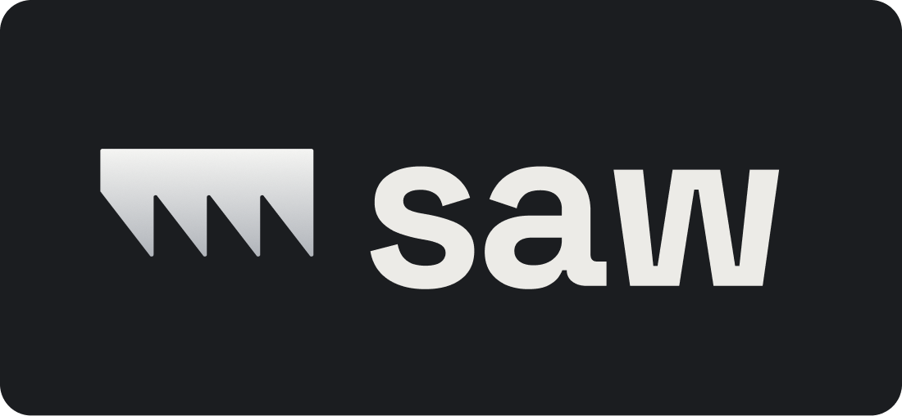
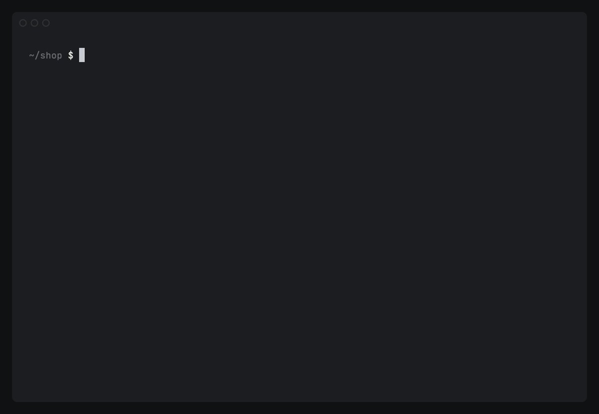

<h1 align="center">
  
</h1>

<p align="center">
  <a href="https://github.com/davidamunga/saw/actions/workflows/ci.yml"></a>
  <a href="https://github.com/davidamunga/saw/releases/latest"></a>
  <a href="https://pkg.go.dev/github.com/davidamunga/saw"></a>
</p>

saw shows a mobile app's logs and network requests, live, from any Android device or emulator, iOS
simulator, or iPhone/iPad, with one command.

<p align="center">
  
</p>

- **One command for every device.** Android and iOS, emulators, simulators and physical devices.
- **Your app only.** No filters to write: saw keeps your app's lines and drops the system's.
- **Full HTTP requests.** Method, URL, status, headers and bodies, from the logging debug builds
  already do, ready to copy as plain HTTP or curl. No proxy, no certificates, no app changes.
- **Survives restarts and crashes.** Relaunch the app and the stream carries on.
- **Made for terminals.** Aligned, copiable output for people; `--json` for scripts, CI and agents.

## Install

```sh
brew install davidamunga/tap/saw                      # macOS
go install github.com/davidamunga/saw/cmd/saw@latest  # anywhere with Go
```

Or download a binary for macOS, Linux or Windows from the
[releases](https://github.com/davidamunga/saw/releases).

saw drives the tools that already talk to devices. Install the ones for the devices you use:

| To read | You need | Install |
|---|---|---|
| Android devices and emulators | adb | `brew install --cask android-platform-tools`, or the Android SDK's platform-tools |
| iOS simulators | Xcode (macOS only) | the Mac App Store |
| iPhones and iPads | pymobiledevice3 | `pipx install pymobiledevice3`; on Linux also usbmuxd, on Windows the Apple Devices app |

Then run `saw doctor`: it checks each tool and every connected device, and says how to fix
anything missing.

## Quick start

```sh
saw devices                                 # what's connected
saw stream --app com.example.app            # the app's logs
saw net --app com.example.app               # the app's network requests
saw net --app com.example.app --full        # ... with headers and bodies, as plain HTTP
```

`--app` takes an Android package name or iOS bundle id, or a short name from [`saw.json`](#sawjson).
With no `--device`, saw uses the only running device; with several, it asks which one.

## Logs: `saw stream`

```
09:41:02.114 I MainActivity       onCreate
09:41:02.380 D OkHttp             --> GET https://api.example.com/v1/orders
09:41:03.002 W SyncWorker         upload failed, retrying (attempt 2 of 5)
09:41:03.441 E Checkout           payment failed: card declined
```

saw shows the app's own lines:

- **Android:** every line written by the app's process, matched by its user id: `Log`, Timber,
  `println`, Flutter, React Native, and crashes.
- **iOS:** every line logged by code inside the app bundle (the app and the frameworks it ships):
  `Logger`/`os_log`, `NSLog`, CocoaLumberjack, React Native, Flutter. Apple's framework lines are
  dropped.

`--scope` narrows it to some tags (Android) or Logger categories (iOS), matched in any case:
`--scope okhttp,syncworker`. To find the names, run `saw stream` once without it: the column after
the level letter is each line's tag or category. `--level warn` hides everything below warnings,
and `--all` shows everything the process logs, system lines included.

## Network: `saw net`

### Requests the app logs

Debug builds usually log every request they make: OkHttp's `HttpLoggingInterceptor` on Android,
and loggers like it on iOS. `saw net` assembles that logging into one line per request, on every
platform, under any tag or category:

```
09:41:02.792  GET    200   538ms   163 B  https://api.example.com/v1/orders
09:41:03.380  POST   402   412ms    61 B  https://api.example.com/v1/payments
09:41:05.020  POST   201   301ms    51 B  https://api.example.com/v1/payments
```

Every line has the same columns (time, method, status, duration, size) and the full URL last, so it
stays aligned and copies cleanly. Lines are stamped when each request finished.

`--full` prints each request as plain HTTP, in the `.http` file format that VS Code's REST Client
and JetBrains' HTTP Client can send again. JSON bodies are indented; everything else is a `#`
comment:

```
### 09:41:05.020  POST 201  301ms
POST https://api.example.com/v1/payments
Content-Type: application/json
Authorization: Bearer ****

{
  "order": "1042",
  "amount": 2400
}

HTTP 201
content-type: application/json

{
  "id": "pay_88",
  "status": "succeeded"
}
```

`--curl` prints each request as a curl command, to paste and send again:

```sh
curl -X POST 'https://api.example.com/v1/payments' \
  -H 'Content-Type: application/json' \
  -H 'Authorization: Bearer ****' \
  --data-raw '{"order":"1042","amount":2400}'
```

saw knows three logging formats:

| Format | Used by | Looks like |
|---|---|---|
| OkHttp-style | OkHttp and Retrofit, and the many loggers that copy it | `--> POST https://…`, headers, body, `<-- 201 https://… (301ms)` |
| Ktor | Ktor's `Logging` plugin | `REQUEST: https://…`, `METHOD: …`, `RESPONSE: 200 OK` |
| Dio | Flutter's Dio `LogInterceptor` | `*** Request ***`, `uri: …`, `statusCode: …` |

Other HTTP-looking lines the app logs (with a URL or a status code in them) appear as `LOG` lines.

What you see is what the app logs: its log level decides whether headers and bodies are included
(OkHttp's `Level.BODY`), and its own redaction of tokens stays. Logs also cap each message's size,
at about 4 KB on Android and 1 KB on iOS, so long bodies can be cut short; `--full` says so when a
body is shorter than its `Content-Length`.

### The network itself

For apps that don't log their requests, and for everything before an app logs its first one,
`saw net` shows what each platform exposes about the app's traffic, without changing anything on
the device:

| Device | Shows | From |
|---|---|---|
| iOS simulator | each request's URL, status, time, protocol and size | Apple's networking logs in the app's process |
| iPhone / iPad | each request's status, time and size, and each new connection's hostname | the same logs (iOS hides URLs on devices), and a packet capture of the app (the TLS server name) |
| Android | each new connection, named by hostnames the app's log mentions, or reverse DNS | the kernel's socket table, which adb can read |

```
09:41:02.114  TLS                         api.example.com:443  203.0.113.7
09:41:02.918  REQ    200   605ms  3.3 KB  (connection 1)  h2
09:41:03.002  TCP                         api.example.com:443  203.0.113.7
```

HTTPS stays encrypted on the network, so this view shows where the app connects and how requests
went, not their contents. Once the app has logged a request, these lines stop, since the logged
requests say more; `--connections` keeps them.

## saw.json

Optional. It gives a project's apps short names and lists its log scopes, so a team can run
`saw stream --app main --scope auth` without knowing package ids, tags or categories. Put it at the
repo root; saw finds the nearest one above the working directory, and `--config` points at another.

```json
{
  "apps": {
    "main": { "android": "com.example.app", "ios": "com.example.app" },
    "admin": { "android": "com.example.admin", "ios": "com.example.admin" }
  },
  "scopes": ["api", "auth", "payments", "push", "ui"],
  "android": { "tag": "Example{Scope}" },
  "ios": { "subsystem": "{bundle}" }
}
```

| Key | Meaning |
|---|---|
| `apps.<name>.android` | The app's Android package name. |
| `apps.<name>.ios` | The app's iOS bundle id. |
| `apps.<name>.process` | Optional. The iOS executable name; read from the device when left out. |
| `scopes` | The app's log scopes, for `--scope`. On iOS each is a Logger category. |
| `android.tag` | The logcat tag for a scope: `{Scope}` → `Api`, `{scope}` → `api`, `{SCOPE}` → `API`. |
| `ios.subsystem` | The app's Logger subsystem. Default `{bundle}`, the bundle id. |

With `scopes` set, `saw stream` shows only those scopes by default: the logcat tags `android.tag`
builds, and Logger lines in the app's subsystem on iOS. `--all` shows everything. With one app
listed, `--app` can be left out. A misspelled key or scope is an error, not silently ignored.

## Commands

| Command | Flags |
|---|---|
| `saw devices` | `--all` includes shut-down simulators; `--json` |
| `saw stream` | `--app`, `--device`, `--platform android\|ios`, `--scope a,b` (repeatable), `--level verbose\|debug\|info\|warn\|error\|fatal`, `--all`, `--json` |
| `saw net` | `--app`, `--device`, `--platform`, and one of `--full`, `--curl` or `--json`; `--connections` |
| `saw doctor` | |
| `saw version` | |

Every command takes `--config <path>`. `--device` takes a device's id, the start of its id, or all
or part of its name (`pixel`, `"17 pro"`).

### JSON

`--json` prints one object per line, leaving out empty fields. `saw stream`:

```json
{"time":"2026-11-09T09:41:02.38+03:00","platform":"android","device":"Pixel 8","process":"com.example.app","pid":4821,"tid":4870,"level":"debug","tag":"OkHttp","message":"--> GET https://api.example.com/v1/orders"}
```

| Field | Meaning |
|---|---|
| `time` | When the line was logged. |
| `platform`, `device` | `android` or `ios`, and the device's name. |
| `process`, `pid`, `tid`, `sender` | The app's process, its ids, and on iOS the binary or library that logged the line. |
| `level` | `verbose`, `debug`, `info`, `warn`, `error` or `fatal`. |
| `tag`, `subsystem`, `category`, `scope` | The logcat tag (Android), Logger subsystem and category (iOS), and the `saw.json` scope. |
| `message` | The log message. |

`saw net`:

```json
{"time":"2026-11-09T09:41:05.02+03:00","started":"2026-11-09T09:41:04.72+03:00","platform":"android","device":"Pixel 8","kind":"logged","url":"https://api.example.com/v1/payments","method":"POST","status":201,"duration_ms":301,"request_headers":[{"name":"Content-Type","value":"application/json"}],"request_body":"{\"order\":\"1042\"}","response_body":"{\"id\":\"pay_88\"}"}
```

| Field | Meaning |
|---|---|
| `kind` | `logged` (a request the app logged), `request` (from Apple's networking logs), `http` (plain HTTP seen on the network), `tls`, `tcp`, `udp`, `dns` (connections), or `log` (another HTTP-looking log line). |
| `time`, `started` | When it happened, or for requests when they finished; and when a logged request was sent. |
| `method`, `url`, `status`, `duration_ms`, `failed`, `error` | The request, its outcome and timing. |
| `request_headers`, `request_body`, `response_headers`, `response_body` | For logged requests: what the app's logging included. |
| `host`, `ip`, `port`, `protocol`, `bytes`, `connection`, `cached` | Network details, where the platform gives them. |
| `log`, `tag`, `level` | For `log` lines: the line, its tag or category, and its level. |

## How it works

saw starts the tool that reads each kind of device, turns its output into one format, filters it
to the app, and prints it:

| Device | Logs | Network |
|---|---|---|
| Android device or emulator | `adb logcat`, filtered by the app's user id | the app's log, and its sockets in `/proc/net` (via adb) |
| iOS simulator (macOS) | `xcrun simctl spawn … log stream` | the app's log, and Apple's networking logs |
| iPhone / iPad | `pymobiledevice3 syslog live`, keeping each line's subsystem and category | the app's log, Apple's networking logs, and `pymobiledevice3 pcap` for TLS server names |

It never installs anything on the device or changes its settings.

## Troubleshooting

| You see | Do this |
|---|---|
| A device shows as `unauthorized` | Unlock it and accept "Allow USB debugging". |
| An iPhone shows as not trusted | Unlock it and tap "Trust This Computer". |
| `more than one device` | Pick one: `--platform android`, or `--device pixel`. |
| `… is not installed on …` | Check the package or bundle id: `adb shell pm list packages \| grep example` on Android. |
| Nothing appears | Is the app running and doing something? Lower `--level`, drop `--scope`, or try `--all`. |
| `saw net` shows only `TCP`, `TLS` or `REQ` lines | The app doesn't log its requests (or not in a format saw knows). Turn on its HTTP logging in debug builds, e.g. OkHttp's `HttpLoggingInterceptor`. |
| `(connection 1)` instead of a URL on an iPhone | iOS hides URLs on devices; the `TLS` line for that connection names its host. |
| `# body cut short in the app's log` | The log's message size limit cut the body. On Android, log long bodies in pieces under 4000 characters, as OkHttp's own logger does. |
| iOS values show as `<private>` | Mark them `privacy: .public` in the `Logger` call. saw points this out when it sees one. |

Known limits:

- iOS: Swift `print` and `printf` write to stdout, not the system log, so no tool can read them
  from a device; only Xcode, attached at launch, sees them. Use `Logger`, `os_log` or `NSLog`.
- iOS app extensions (widgets, notification services) run as their own processes and aren't included.
- Release builds often strip logging; saw shows only what the app emits.

## Develop

```sh
go test ./...
go build -o bin/saw ./cmd/saw
```

Tests run saw against fake `adb`, `xcrun` and `pymobiledevice3` (see `internal/runtest`), so they
need no devices; `testdata/` holds real captured log output for the parsers.

To release, tag and push: `git tag -a vX.Y.Z -m vX.Y.Z && git push origin vX.Y.Z`. The release
workflow builds every platform with GoReleaser, publishes a GitHub release and updates the Homebrew
tap.

## License

[MIT](LICENSE)
